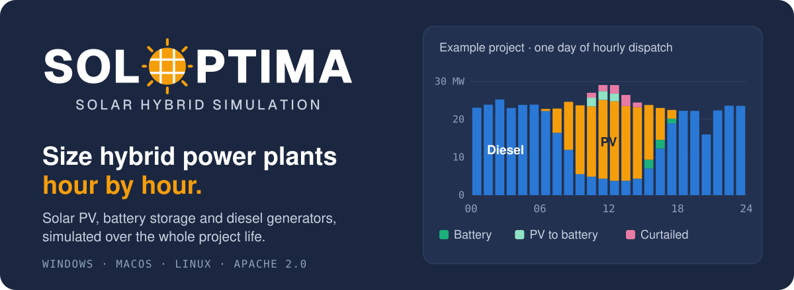
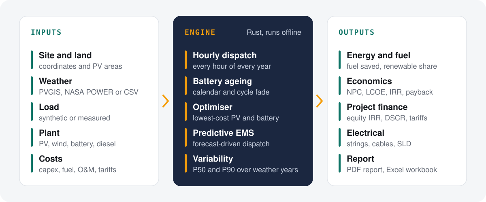

<p align="center">
  
</p>

<p align="center">
  <a href="https://github.com/Marcel-Bonifacio/Soloptima/releases/latest/download/Soloptima-Setup-windows-x64.exe"></a>
  &nbsp;
  <a href="https://github.com/Marcel-Bonifacio/Soloptima/releases/latest/download/Soloptima-mac.dmg"></a>
  &nbsp;
  <a href="https://github.com/Marcel-Bonifacio/Soloptima/releases/latest/download/Soloptima-linux-x86_64.AppImage"></a>
</p>

<p align="center">
  Windows 10 or 11 (64-bit) · macOS 11 or later (Apple silicon and Intel) · Linux x86_64 (glibc 2.31 or later, for example Ubuntu 20.04 and later)<br>
  <a href="https://github.com/Marcel-Bonifacio/Soloptima/releases">All releases</a> · <a href="#download-and-install">Download and install</a> · <a href="docs/MANUAL.md">Manual</a> · <a href="#build-from-source">Build from source</a>
</p>

Soloptima sizes and models hybrid power plants that combine solar PV, battery energy storage (BESS) and diesel generators, with optional wind turbines. You give it a site, a load profile and the generator fleet. It simulates every hour of the project life, searches for the lowest-cost PV and battery sizes, and works out the fuel savings and the project finance. The results go into an engineering report and an Excel workbook.

Soloptima is a desktop application for Windows, macOS and Linux. A Rust engine does the modelling on your computer, and the interface opens in the application's own window. There is no account and no cloud service. Projects are plain files on disk, and Soloptima tells you when a new version is out.

## How it works

<p align="center">
  
</p>

The engine simulates every hour of every project year. It commits gensets for the load plus spinning reserve, keeps them above their minimum loading, charges the battery from surplus PV and computes fuel from each unit's part-load curve. Battery health falls by calendar and cycle fade, and the battery is replaced when it reaches its threshold. For control, choose load following, cycle charging, or a predictive EMS that plans on PV and load forecasts. The Forecast Lab compares 10 PV and 11 load forecasting methods and shows what each one is worth in fuel.

- On the layout map you draw the land and the tool fills it with module tables. Buildings and trees beside the array, with their heights, shade each table over the year on top of the terrain horizon. Roof faces and canopies can have their own tilt and azimuth, and areas come in from KML, KMZ, GeoJSON or OpenStreetMap. A drone or survey image with its world file can go under the map, and a click on a roof traces its outline from that image. Roads and walkways, clearances around obstacles and access aisles keep tables off the ground you need, tables can be taken out by hand, and drawing changes can be undone.
- The optimiser runs a full lifecycle simulation for every candidate design, in parallel. It offers an exhaustive grid with pattern search, PSO, MOPSO (a Pareto front of cost against renewable fraction) and a hybrid SHO-QAO-GOA, with limits on unmet load, renewable fraction, curtailment, land and capex. With rule-based dispatch the engine runs about 150 full 25-year simulations per CPU-second on the example project.
- Weather comes from PVGIS or NASA POWER, or from your own station file. Load is a synthetic profile or a logger file. Imported files are averaged to hours with a gap report, then checked: weather for timestamps that disagree with the sun, values outside physical limits and stuck readings, load for outages, spikes, level shifts and unit errors. Running year 1 with every historical weather year gives P50 to P99 yield and revenue.
- Each result is measured against the same fleet on diesel alone: fuel saved, NPC, LCOE, IRR, payback. The battery gets its own NPV against PV only, because a hybrid can beat diesel by a wide margin while its battery loses money. Records from an existing plant (fuel, generation, run hours) check the diesel-only case.
- Project finance is an annual after-tax cash flow for host-owned, single-owner PPA, third-party and tax equity partnership flip structures, with debt sized by gearing or DSCR sculpting and paid yearly, semi-annually, quarterly or monthly, a loan or tariff in another currency with an exchange rate sensitivity, tax, staged tariffs and a solver for the tariff that meets a target IRR. The formulas are in [docs/FINANCE.md](docs/FINANCE.md).
- Electrical design covers string sizing, transformers, cables, an AC load flow over all 8,760 hours and the single-line diagram.
- Results go into an engineering report (print it or save it as PDF) and an Excel workbook with every input, result and hourly series. For studies the pages do not cover, a script console runs parameter sweeps and Monte Carlo runs through the engine.

[docs/MANUAL.md](docs/MANUAL.md) describes every page and model, and lists the known limitations.

## Download and install

You do not need Rust, Node.js, Python or any other tool to use Soloptima. Each download below is the complete program: install it like any other app. The setup programs need no internet connection, and Soloptima works offline. Only the map, weather downloads (and forecasts) and the update check need the internet. Projects, simulations, the optimiser, finance and reports all run on your computer.

### Which file do I need?

| Your computer | Download this file | Notes |
|---|---|---|
| Windows 10 or 11 (64-bit) | [Soloptima-Setup-windows-x64.exe](https://github.com/Marcel-Bonifacio/Soloptima/releases/latest/download/Soloptima-Setup-windows-x64.exe) | A setup program with a few pages to click through. No administrator rights needed. |
| Mac with macOS 11 or later | [Soloptima-mac.dmg](https://github.com/Marcel-Bonifacio/Soloptima/releases/latest/download/Soloptima-mac.dmg) | One file for every Mac, Apple silicon and Intel. |
| Linux, any distribution (x86_64) | [Soloptima-linux-x86_64.AppImage](https://github.com/Marcel-Bonifacio/Soloptima/releases/latest/download/Soloptima-linux-x86_64.AppImage) | Runs without installing and updates itself. |
| Ubuntu or Debian (x86_64) | [Soloptima-linux-x86_64.deb](https://github.com/Marcel-Bonifacio/Soloptima/releases/latest/download/Soloptima-linux-x86_64.deb) | Installs like other Ubuntu software. Soloptima does not update this copy itself. |

For a computer without internet, download the file on another computer and copy it over, for example on a USB stick.

The builds are not code-signed yet, so Windows and macOS show a security warning the first time. The steps below say what to click; [Signing](#signing) explains how signed builds are made.

### Windows

1. Double-click `Soloptima-Setup-windows-x64.exe`.
2. If Windows shows **Windows protected your PC**, select **More info**, then **Run anyway**.
3. The setup program opens on a welcome page. Select **Next**.
4. Read the licence (Apache License 2.0), tick **I accept the terms of the licence agreement** and select **Next**.
5. Keep the suggested folder and select **Install**. Soloptima installs for your user account only, in `%LOCALAPPDATA%\Programs\Soloptima`, and adds a Start menu shortcut.
6. Leave **Start Soloptima** ticked and select **Finish**.

Soloptima's window uses the Microsoft Edge WebView2 Runtime. Windows 11 and current Windows 10 already have it; if it is missing, the setup program installs the copy it carries, without a download.

Uninstall from **Settings > Apps**; your profiles and projects stay in place.

### macOS

1. Double-click `Soloptima-mac.dmg`. A window opens with Soloptima and the Applications folder.
2. Drag Soloptima onto Applications.
3. The first time only: open Applications, right-click Soloptima (or Control-click), select **Open**, then confirm with **Open**. A plain double-click is blocked once because the app is not notarised by Apple yet. On macOS 15 and later, if no Open button appears, go to System Settings > Privacy & Security and select **Open Anyway**.
4. After that, start Soloptima like any other app. Close the window or press Cmd+Q to quit; your work is saved first.

Starting Soloptima while it is already running brings its window to the front.

### Linux

AppImage:
1. Make the file executable: right-click it, open **Properties > Permissions** and tick **Allow executing file as program** (or run `chmod +x Soloptima-linux-x86_64.AppImage`).
2. Double-click it.
3. The AppImage carries its own FUSE library, so `libfuse2` is not needed, but the system must support FUSE, as almost every desktop does. If it still does not start and mentions FUSE, run it from a terminal with `./Soloptima-linux-x86_64.AppImage --appimage-extract-and-run`, or install FUSE (`sudo apt install fuse3`).

Debian and Ubuntu package: run `sudo apt install ./Soloptima-linux-x86_64.deb` in the folder that holds the file. It needs `libwebkit2gtk-4.1-0` and `libgtk-3-0`, which apt installs when they are missing; that takes a connection to your package source, so on a computer without internet the AppImage is the simpler choice. Soloptima does not update a .deb copy: install the next .deb over it.

### First start

The first time Soloptima opens:
1. It shows the licence (Apache License 2.0) and the terms of use, each with its own tick box. A box unlocks once you have scrolled its text to the end. Tick both and select **Accept and continue**.
2. Create your profile: your name, and if you like your organisation and email. Select **Create profile and continue**.

There is no online account, password or sign-up: the profile is kept on your computer and keeps your projects apart from those of other people who use it.

### Updates

After you sign in, Soloptima checks GitHub for a newer release, at most once a day. When there is one, **Update to x.y.z** appears in the top bar with the release notes. Nothing is downloaded until you choose **Download and install**. Soloptima then checks that the download carries a valid release signature for that version; a missing or wrong signature stops the update and the download is discarded. If the check passes, Soloptima saves your work and installs it:
- on Windows, the setup program installs the new version over the old one and starts it;
- on macOS, Soloptima replaces itself in its folder and starts again;
- on Linux, the AppImage replaces its own file and starts again.

**Settings > Updates** turns the automatic check off and has **Check now**; on macOS the application menu also has **Check for Updates…**. **Skip this version** in the update window hides a release until the next one comes out. A copy that cannot replace itself (the Linux .deb, or a build run from the source folder) offers the release page instead.

## Getting started

The first screen shows the licence and the terms of use; accept both, then create your profile (see [First start](#first-start)). Profiles keep projects separate on a shared computer and have no password.

**Open the example study** loads the example project, a complete reference case: a generic off-grid industrial site with 30 MWp of PV, a 6.6 MWh battery and 20 × 1.8 MW diesel generators, with PVGIS weather data included. The chart at the top of this page is one day of its simulation. The pages in the left sidebar follow the workflow in order, from site and solar resource through to results, finance and the report.

The example coordinates are a placeholder. Set the actual site location before relying on any result.

## Data storage

Projects are saved automatically.

| System | Default folder |
|---|---|
| Windows | `%LOCALAPPDATA%\Soloptima` |
| macOS | `~/Library/Application Support/Soloptima` |
| Linux | `~/.local/share/Soloptima` |

You can change the folder under **Settings** in the user menu. For a portable installation, for example on a USB drive, create an empty `data\users` folder next to the executable; Soloptima then uses it instead of the default location.

**Export .json** produces a self-contained project file. It includes the weather and load data, so it also runs offline and from the command line. Google Maps and Open-Meteo API keys are left out of exported files.

## Network access

All modelling runs offline. Soloptima goes online only for weather data (PVGIS, NASA POWER), weather forecasts (Open-Meteo, MET Norway), map tiles, place search and OpenStreetMap building outlines, which include the site coordinates, and for update checks (GitHub), which include no project data. [TERMS.md](TERMS.md) lists exactly what is sent to each service.

The engine runs inside the application and the window reaches it through Tauri commands: there is no network port and no local server, so the engine is not reachable from other programs or other machines.

## Command-line use

The engine also runs projects without the window (`cargo build --release -p soloptima-engine` builds `target/release/soloptima`):

```bash
target/release/soloptima simulate web/examples/example_study.json results.json
target/release/soloptima optimize web/examples/example_study.json optimum.json
```

`optimize` reads the project's `optimizer` block. Projects saved from the GUI store C-rates and sensitivity values as text, so a headless run uses a C-rate of 0.5 and no sensitivity cases.

## Build from source

The app is a Tauri 2 shell (`src-tauri/`, Rust) with the Rust engine (`engine/`) linked into it; the interface is Svelte 5 in `ui/`, built into `web/ui/app.js` and shown by `web/index.html`, and its map and chart libraries and fonts are bundled in `web/vendor/`, so nothing depends on a CDN. The window uses the system's own web engine: WebKit on macOS, Microsoft Edge WebView2 on Windows, WebKitGTK on Linux. You need [Rust](https://rustup.rs) and the Tauri prerequisites of your system (https://tauri.app/start/prerequisites/). The interface build (`ui/`, see `docs/ui.md`) also needs [Node.js](https://nodejs.org) 22 or later. On a Mac, double-clicking `Soloptima.command` does the build and starts the app.

```bash
npm --prefix ui ci && npm --prefix ui run build   # the interface into web/ui/ (build again after each change in ui/; `npm --prefix ui run watch` rebuilds on save)
cargo run -p soloptima-app            # the app in a window (development build)
cargo run -p soloptima-app -- --data /tmp/soloptima-test   # with another projects folder
```

`cargo build --release -p soloptima-engine` builds the engine's command line on its own (`target/release/soloptima simulate|optimize project.json`), which needs only Rust.

### Tests

`cargo test` runs the engine tests (`engine/tests/`, many of them against answers of the version 1 engine kept in `engine/tests/fixtures/`) and the shell's (release keys); `cargo test --release` also runs the slow ones. [docs/VALIDATION.md](docs/VALIDATION.md) says how the results compare with version 1. The interface tests need Node.js: `node tests/layout_geometry.test.js && node --test ui/tests/*.test.js`.

## Packaging and releases

The installers are built by Tauri from `src-tauri/tauri.conf.json`. `packaging/bundle.sh` builds those of the system it runs on and copies them to `dist/` under the release names:

| System | Files | Update file |
|---|---|---|
| macOS (universal) | `Soloptima-mac.dmg`, `Soloptima-mac.app.tar.gz` | `Soloptima-mac.app.tar.gz` |
| Windows x64 | `Soloptima-Setup-windows-x64.exe` (NSIS, per-user, with the offline WebView2 Runtime installer), `Soloptima-Update-windows-x64.exe` (the same without it) | `Soloptima-Update-windows-x64.exe` |
| Linux x86_64 | `Soloptima-linux-x86_64.AppImage`, `Soloptima-linux-x86_64.deb` | the AppImage |

The Windows setup program shows a welcome page, the licence with a required tick box, the folder and a finish page that starts the app; the pictures come from `packaging/installer-art.py`, and `/P` and the updater skip every page. The download, `Soloptima-Setup-windows-x64.exe`, carries Microsoft's offline WebView2 Runtime installer, so it installs without internet, at the cost of well over 100 MB. `bundle.sh` builds the setup program a second time without it (`webviewInstallMode` `downloadBootstrapper`) as `Soloptima-Update-windows-x64.exe`, the file `latest.json` names: a computer that updates already has WebView2, so updates stay small. Copies of version 1.x still update once through the full setup program, which `SHA256SUMS.txt` lists.

Building needs Rust, the Tauri CLI (`cargo install tauri-cli --version "^2" --locked`) and each system's build tools (see the comment at the top of the script). The **Installers** workflow (`.github/workflows/bundles.yml`, started from the Actions tab) builds the Windows and Linux installers on GitHub's machines.

### Publishing a release

1. Set the version in `Cargo.toml` (`[workspace.package]`; the engine and the shell take it from there).
2. On the Mac: `./packaging/bundle.sh`. Run the **Installers** workflow and put its Windows and Linux files in `dist/` as well. Write the release notes to `dist/NOTES.md`; the update window shows them.
3. Sign the release (minisign asks for the key's password once per signed file):

   ```bash
   SOLOPTIMA_MINISIGN_KEY=~/.minisign/soloptima-primary.key ./packaging/sign.sh
   ```

   This writes a `.sig` for each update file (on Windows `Soloptima-Update-windows-x64.exe`; the script stops if it is missing beside the full setup program), `latest.json` (the update manifest) and `SHA256SUMS.txt` with `SHA256SUMS.txt.minisig`. A signature that does not verify with a key in `RELEASE_KEYS` is deleted and the script stops.
4. Create a GitHub release tagged `v<version>` (for example `v2.0.0`) and attach every file in `dist/` under its name: the installers, the `.sig` files, `latest.json`, `SHA256SUMS.txt` and `SHA256SUMS.txt.minisig`.

The update check reads `latest.json` of the latest release, and the download buttons at the top of this page point to the installer names. `SHA256SUMS.txt` and its signature are what copies of version 1.x check before they update.

### Signing

There are two signatures: the platform's code signature (optional, so the system trusts the app) and the Soloptima release signature (always, so installed copies trust the update).

<details>
<summary><b>Platform signing variables</b> (read by <code>packaging/bundle.sh</code>)</summary>

| Variable | Effect |
|---|---|
| `APPLE_SIGNING_IDENTITY` (macOS) | A "Developer ID Application" identity in the keychain (Apple Developer Program). Tauri signs the app with the hardened runtime. Without it the app is ad-hoc signed. |
| `APPLE_ID`, `APPLE_PASSWORD`, `APPLE_TEAM_ID` (macOS) | With the identity: Tauri notarises the app with Apple (the password is an app-specific password), so it opens without a warning. |
| `SOLOPTIMA_SIGN_CMD` (Windows) | A command that signs the file given as its last argument, for example `signtool sign /fd SHA256 /tr http://timestamp.digicert.com /td SHA256 /a`. Tauri signs `Soloptima.exe` and the setup program with it. |

Apple signing needs a Mac. The Linux packages carry no platform signature. For Windows, a code-signing certificate from a certificate authority (held in a cloud key service or on a hardware token) and Microsoft's Artifact Signing service both work with `SOLOPTIMA_SIGN_CMD`.

</details>

#### Release signature

Every update file is signed with a Soloptima release key using minisign. An installed copy installs an update only when its signature in `latest.json` verifies with a key built into it (`RELEASE_KEYS` in `src-tauri/src/update.rs`) and the signature's trusted comment names the version that `latest.json` announces, so an older signed file cannot pose as a newer release. You type the key's password; `packaging/sign.sh` never stores it, and the secret key file never leaves your computer.

There are two keys: the primary signs releases, and the backup is kept offline. If the primary is lost or exposed, sign the next release with the backup (`SOLOPTIMA_MINISIGN_KEY=<backup key file>`) and remove the primary from `RELEASE_KEYS`.

## Documentation

- [docs/MANUAL.md](docs/MANUAL.md): each page of the application, the models behind the results, and known limitations
- [docs/FINANCE.md](docs/FINANCE.md): project finance formulas and presets
- [docs/VALIDATION.md](docs/VALIDATION.md): how the results compare with version 1, and how to check
- [docs/ipc.md](docs/ipc.md) and [docs/ui.md](docs/ui.md): the shell's commands and the interface's structure
- [docs/LITERATURE.md](docs/LITERATURE.md): what was adopted from the published papers, the corrections made, and what was left out

Every input with an ⓘ button in the application has a short explanation and a typical value.

## Bug reports

**Report** in the top bar creates a bug report and saves it as a file in the data folder. Nothing is sent automatically. To share a report, open a [GitHub issue](https://github.com/Marcel-Bonifacio/Soloptima/issues) and paste the output of **Copy for an issue**, which leaves out the reporter name, project data and notes.

## Licence

Soloptima is open source under the [Apache License 2.0](LICENSE). You may use, change and distribute it, commercially or not, under the conditions of that licence; copies you pass on must include [NOTICE](NOTICE).

The [terms of use](TERMS.md) add the engineering and data-provider conditions. [THIRD_PARTY_NOTICES.md](THIRD_PARTY_NOTICES.md) lists the bundled libraries with the licence of each.
