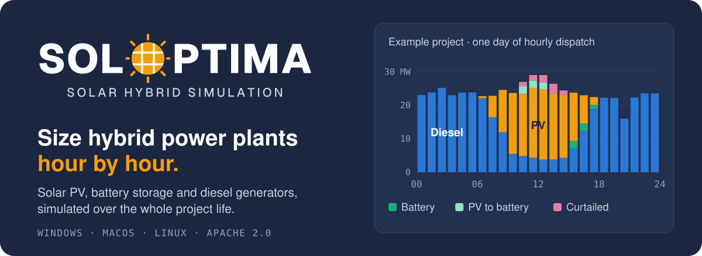
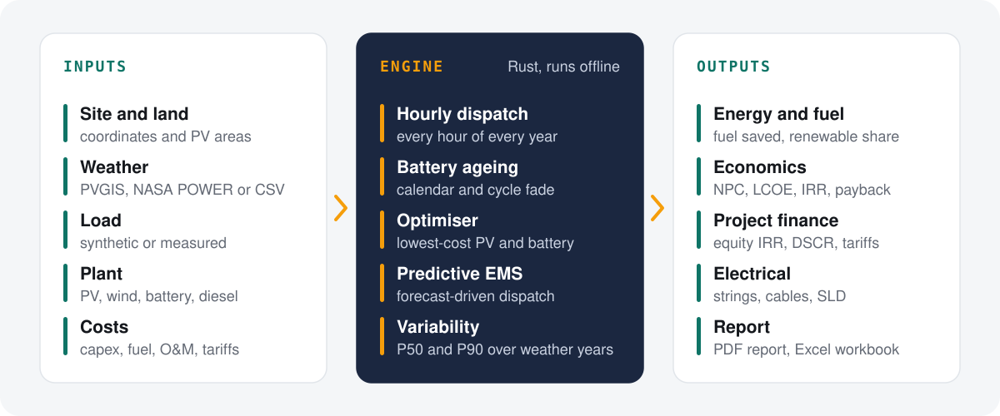

<p align="center">
  
</p>

<p align="center">
  <a href="https://github.com/Marcel-Bonifacio/Soloptima/releases/latest/download/Soloptima-Setup-windows-x64.exe"></a>
  &nbsp;
  <a href="https://github.com/Marcel-Bonifacio/Soloptima/releases/latest/download/Soloptima-mac.dmg"></a>
  &nbsp;
  <a href="https://github.com/Marcel-Bonifacio/Soloptima/releases/latest/download/Soloptima-linux-x86_64.AppImage"></a>
</p>

<p align="center">
  <a href="https://github.com/Marcel-Bonifacio/Soloptima/releases/latest"></a>
  <a href="LICENSE"></a>
  
</p>

<p align="center">
  Windows 10 or 11 (64-bit) · macOS 11 or later (Apple silicon and Intel) · Linux x86_64 (glibc 2.31 or later, for example Ubuntu 20.04 and later)<br>
  <a href="#download-and-install">Download and install</a> · <a href="docs/MANUAL.md">Manual</a> · <a href="#literature-review">Literature review</a> · <a href="https://github.com/Marcel-Bonifacio/Soloptima/releases">Release notes</a> · <a href="#build-from-source">Build from source</a>
</p>

Soloptima is a desktop tool for sizing and modelling hybrid power plants. It covers solar PV, battery energy storage (BESS) and diesel generators, with wind turbines and a grid connection as options, for off-grid and on-grid sites.

Soloptima simulates every hour of the project life, searches for the lowest-cost PV and battery sizes, and works out the fuel saved and the project finance.

Everything runs on your own computer. There is no account and no cloud service, projects are plain files on disk, and the app tells you when a new version is out.

## What's new in 2.2.0

- A native 3D view of the site on your graphics card, on top of the satellite map, with fourteen roof and building shapes that shade the PV exactly as drawn.
- The electrical design now runs in the engine, with kVA ratings, power factor, weak grid checks, single-feeder outages and unbalanced faults.
- A loss diagram for the whole system, from the sunlight to the energy served, including the battery and the plant.
- Custom project lifetimes from 1 to 60 years, and your own pictures and 3D views in the report.

Every new option is off by default, so a 2.1 project gives the same results until you switch something on. The full list is in the [release notes](https://github.com/Marcel-Bonifacio/Soloptima/releases/tag/v2.2.0).

## How it works

<p align="center">
  
</p>

The engine simulates every hour of every project year. It commits gensets for the load plus spinning reserve, keeps them above their minimum loading, charges the battery from surplus PV and works out fuel from each unit's part-load curve. Battery health falls with calendar and cycle ageing, and the battery is replaced when it reaches its end-of-life threshold. For control you can choose load following, cycle charging, or a predictive EMS that plans ahead on PV and load forecasts. The Forecast Lab compares 10 PV and 11 load forecasting methods and shows what each one is worth in fuel.

### Site layout and shading

You draw the land on the map and Soloptima fills it with module tables. Areas can also come in from KML, KMZ, GeoJSON or OpenStreetMap, and a drone or survey image with its world file can go under the map.

Buildings and trees shade each table over the year, on top of the terrain horizon and on sloped ground too. Roofs can be flat, gable, hip or shed, and also flat with a parapet, mansard, gambrel, butterfly, sawtooth, pyramid, barrel vault, cone or spire, and dome. Round buildings such as silos and tanks are covered as well. Trees take round, cone, palm or column crowns.

One click puts panels flush on the sunny planes of a roof, with 1 m kept clear of the roof edge and shorter tables where the roof is narrow. Carports get their own canopy height. Roads, walkways, access aisles and clearances around obstacles keep tables off the ground you need.

The 3D view runs on your graphics card (Metal, Direct3D 12 or Vulkan). It shows the modules, their mounting structures and live sun shadows over the satellite map, and you can move, turn and resize anything with handles. The yield model shades with the same shapes you see.

### Sizing and dispatch

The optimiser runs a full lifecycle simulation for every candidate design, in parallel. It offers an exhaustive grid with pattern search, PSO, MOPSO and a hybrid SHO-QAO-GOA. MOPSO gives a Pareto front of cost against renewable fraction, unmet load or CO2. The search can also size the number of gensets and their unit rating, and can be repeated to show how much the answer spreads. Limits can be set on unmet load, renewable fraction, curtailment, land and capex. With rule-based dispatch the engine runs about 150 full 25-year simulations per CPU-second on the example project.

The dispatch can also hold a critical share of the load, shift a deferrable load such as water pumping, charge the battery from the grid ahead of a planned outage or when time-of-use prices make it worth it, and keep a frequency reserve. Gensets can have minimum up and down times, start costs, and overhauls by run hours.

### Weather and load

Weather comes from PVGIS [1] or NASA POWER [2], or from your own station file. Load is a synthetic profile, an appliance list or a logger file. Imported files are averaged to hours with a gap report and then checked. Weather is checked for timestamps that disagree with the sun, values outside physical limits and stuck readings, and load for outages, spikes, level shifts and unit errors. Running year 1 with every historical weather year gives P50 to P99 yield and revenue.

### Economics and finance

Each result is measured against the same fleet on diesel alone, which gives the fuel saved, NPC, LCOE, IRR and payback. The battery gets its own NPV against PV only, because a hybrid can beat diesel by a wide margin while its battery still loses money. Records from an existing plant (fuel, generation and run hours) can be used to check the diesel-only case.

Project finance is an annual after-tax cash flow for host-owned, single-owner PPA, third-party and tax equity partnership flip structures. Debt is sized by gearing or DSCR sculpting and can be paid yearly, semi-annually, quarterly or monthly. It also handles a loan or tariff in another currency with an exchange rate sensitivity, tax, staged tariffs, and a solver for the tariff that meets a target IRR. The formulas are in [docs/FINANCE.md](docs/FINANCE.md).

### Electrical design

The electrical design covers string sizing, transformers, cables, an AC load flow over all 8,760 hours, short circuit and protection, and the single-line diagram. Inverters can carry a kVA rating, and a power factor at the grid connection checks their reactive capability. Further checks cover weak grids (short-circuit ratio and the transformer energising dip), losing one feeder at a time, and unbalanced faults.

### Results and reports

The results show energy, fuel, battery health, the renewable fraction and a loss diagram for the whole system or for the PV, the plant and the battery on their own. An outage study gives the chance that the critical load is still served after a grid outage of 1 to 336 hours. Metered PV output can be compared with the model to fit soiling and availability, and every simulation checks its own results for values outside a plausible range.

Everything goes into an engineering report, which you can print or save as PDF, and an Excel workbook with every input, result and hourly series. The report follows the number of years you simulate and can carry the 3D view and your own site pictures. For studies the pages do not cover, a script console runs parameter sweeps and Monte Carlo runs through the engine.

[docs/MANUAL.md](docs/MANUAL.md) describes every page and model and lists the known limitations. The [literature review](#literature-review) below covers the journal papers behind the models and the gaps they show.

## Download and install

The setup programs need no internet connection and Soloptima works offline. Only the map, weather downloads, forecasts and the update check go online.

### Which file do I need?

| Your computer | Download this file | Notes |
|---|---|---|
| Windows 10 or 11 (64-bit) | [Soloptima-Setup-windows-x64.exe](https://github.com/Marcel-Bonifacio/Soloptima/releases/latest/download/Soloptima-Setup-windows-x64.exe) | A setup program with a few pages to click through. No administrator rights needed. |
| Mac with macOS 11 or later | [Soloptima-mac.dmg](https://github.com/Marcel-Bonifacio/Soloptima/releases/latest/download/Soloptima-mac.dmg) | One file for every Mac, Apple silicon and Intel. |
| Linux, any distribution (x86_64) | [Soloptima-linux-x86_64.AppImage](https://github.com/Marcel-Bonifacio/Soloptima/releases/latest/download/Soloptima-linux-x86_64.AppImage) | Runs without installing and updates itself. |
| Ubuntu or Debian (x86_64) | [Soloptima-linux-x86_64.deb](https://github.com/Marcel-Bonifacio/Soloptima/releases/latest/download/Soloptima-linux-x86_64.deb) | Installs like other Ubuntu software. Soloptima does not update this copy itself. |

For a computer without internet, download the file on another computer and copy it over, for example on a USB stick.

The builds are not code-signed yet, so Windows and macOS show a security warning the first time. The steps below say what to click, and [Signing](#signing) explains how signed builds are made. Every release is still signed with the Soloptima release key, and `SHA256SUMS.txt` on each release lets you check the files you downloaded.

### Windows

1. Double-click `Soloptima-Setup-windows-x64.exe`.
2. If Windows shows **Windows protected your PC**, select **More info**, then **Run anyway**.
3. The setup program opens on a welcome page. Select **Next**.
4. Read the licence (Apache License 2.0), tick **I accept the terms of the licence agreement** and select **Next**.
5. Keep the suggested folder and select **Install**. Soloptima installs for your user account only, in `%LOCALAPPDATA%\Programs\Soloptima`, and adds a Start menu shortcut.
6. Leave **Start Soloptima** ticked and select **Finish**.

Soloptima's window uses the Microsoft Edge WebView2 Runtime. Windows 11 and current Windows 10 already have it. If it is missing, the setup program installs the copy it carries, without a download.

Uninstall from **Settings > Apps**. Your profiles and projects stay where they are.

### macOS

1. Double-click `Soloptima-mac.dmg`. A window opens with Soloptima and the Applications folder.
2. Drag Soloptima onto Applications.
3. The first time only, open Applications, right-click Soloptima (or Control-click), select **Open** and confirm with **Open**. A plain double-click is blocked once because the app is not notarised by Apple yet. On macOS 15 and later, if no Open button appears, go to **System Settings > Privacy & Security** and select **Open Anyway**.
4. After that, start Soloptima like any other app. Close the window or press Cmd+Q to quit, and your work is saved first.

Starting Soloptima while it is already running brings its window to the front.

### Linux

**AppImage**

1. Make the file executable. Right-click it, open **Properties > Permissions** and tick **Allow executing file as program**, or run `chmod +x Soloptima-linux-x86_64.AppImage`.
2. Double-click it.
3. The AppImage carries its own FUSE library, so `libfuse2` is not needed, but the system must support FUSE, as almost every desktop does. If it still does not start and mentions FUSE, run `./Soloptima-linux-x86_64.AppImage --appimage-extract-and-run` from a terminal, or install FUSE with `sudo apt install fuse3`.

**Debian and Ubuntu package**

Run `sudo apt install ./Soloptima-linux-x86_64.deb` in the folder that holds the file. It needs `libwebkit2gtk-4.1-0` and `libgtk-3-0`, which apt installs when they are missing. That takes a connection to your package source, so on a computer without internet the AppImage is the simpler choice. Soloptima does not update a .deb copy, so install the next .deb over it.

### First start

The first time Soloptima opens, it shows the licence (Apache License 2.0) and the terms of use, each with its own tick box. A box unlocks once you have scrolled its text to the end. Tick both and select **Accept and continue**.

Then create your profile with your name, and your organisation and email if you like, and select **Create profile and continue**. There is no online account, password or sign-up. The profile stays on your computer and keeps your projects apart from those of other people who use it.

### Updates

After you sign in, Soloptima checks GitHub for a newer release, at most once a day. When there is one, **Update to x.y.z** appears in the top bar with the release notes. Nothing is downloaded until you choose **Download and install**.

Soloptima then checks that the download carries a valid release signature for that version. A missing or wrong signature stops the update and the download is thrown away. If the check passes, Soloptima saves your work and installs the update.

- On Windows, the setup program installs the new version over the old one and starts it.
- On macOS, Soloptima replaces itself in its folder and starts again.
- On Linux, the AppImage replaces its own file and starts again.

**Settings > Updates** turns the automatic check off and has **Check now**. On macOS the application menu also has **Check for Updates…**. **Skip this version** in the update window hides a release until the next one comes out. A copy that cannot replace itself (the Linux .deb, or a build run from the source folder) opens the release page instead.

## Getting started

**Open the example study** loads the example project, a complete reference case. It is a generic off-grid industrial site with 30 MWp of PV, a 6.6 MWh battery and 20 × 1.8 MW diesel generators, with PVGIS weather data included. The chart at the top of this page is one day of its simulation.

The pages in the left sidebar follow the workflow in order, from the site and solar resource through to the results, finance and the report. Every input with an ⓘ button has a short explanation and a typical value.

The example coordinates are a placeholder, so set the real site location before you rely on any result.

## Data and privacy

Projects are saved automatically.

| System | Default folder |
|---|---|
| Windows | `%LOCALAPPDATA%\Soloptima` |
| macOS | `~/Library/Application Support/Soloptima` |
| Linux | `~/.local/share/Soloptima` |

You can change the folder under **Settings** in the user menu. For a portable installation, for example on a USB drive, create an empty `data\users` folder next to the executable and Soloptima uses it instead.

**Export .json** writes a self-contained project file. It includes the weather and load data, so it also runs offline and from the command line. Google Maps and Open-Meteo API keys are left out of exported files.

All modelling runs offline. Soloptima only goes online for weather data (PVGIS, NASA POWER), weather forecasts (Open-Meteo, MET Norway), map tiles, place search and OpenStreetMap building outlines, which include the site coordinates, and for update checks (GitHub), which include no project data. [TERMS.md](TERMS.md) lists exactly what is sent to each service.

The engine runs inside the app and the window talks to it through Tauri commands. There is no network port and no local server, so other programs and other machines cannot reach the engine.

## Command-line use

The engine also runs projects without the window. `cargo build --release -p soloptima-engine` builds `target/release/soloptima`, which needs only Rust.

```bash
target/release/soloptima simulate web/examples/example_study.json results.json
target/release/soloptima optimize web/examples/example_study.json optimum.json
```

`optimize` reads the project's `optimizer` block. Projects saved from the app store C-rates and sensitivity values as text, so a headless run uses a C-rate of 0.5 and no sensitivity cases.

## Build from source

The app is a Tauri 2 shell (`src-tauri/`, Rust) with the Rust engine (`engine/`) linked into it. The interface is Svelte 5 in `ui/`, built into `web/ui/app.js` and shown by `web/index.html`. Its map and chart libraries and fonts are bundled in `web/vendor/`, so nothing depends on a CDN. The window uses the system's own web engine, which is WebKit on macOS, Microsoft Edge WebView2 on Windows and WebKitGTK on Linux.

You need [Rust](https://rustup.rs), the [Tauri prerequisites](https://tauri.app/start/prerequisites/) of your system and [Node.js](https://nodejs.org) 22 or later for the interface (see `docs/ui.md`). On a Mac, double-clicking `Soloptima.command` builds the app and starts it.

```bash
npm --prefix ui ci && npm --prefix ui run build   # the interface into web/ui/ (`npm --prefix ui run watch` rebuilds on save)
cargo run -p soloptima-app                         # the app in a window (development build)
cargo run -p soloptima-app -- --data /tmp/soloptima-test   # with another projects folder
```

### Tests

`cargo test` runs the engine tests in `engine/tests/`, many of them against answers of the version 1 engine kept in `engine/tests/fixtures/`, and the shell's tests. `cargo test --release` also runs the slow ones. [docs/VALIDATION.md](docs/VALIDATION.md) explains how the results compare with version 1.

The interface tests need Node.js.

```bash
node tests/layout_geometry.test.js && node --test ui/tests/*.test.js
```

## Packaging and releases

Tauri builds the installers from `src-tauri/tauri.conf.json`. `packaging/bundle.sh` builds those of the system it runs on and copies them to `dist/` under the release names.

| System | Files | Update file |
|---|---|---|
| macOS (universal) | `Soloptima-mac.dmg`, `Soloptima-mac.app.tar.gz` | `Soloptima-mac.app.tar.gz` |
| Windows x64 | `Soloptima-Setup-windows-x64.exe` (NSIS, per-user, with the offline WebView2 Runtime installer), `Soloptima-Update-windows-x64.exe` (the same without it) | `Soloptima-Update-windows-x64.exe` |
| Linux x86_64 | `Soloptima-linux-x86_64.AppImage`, `Soloptima-linux-x86_64.deb` | the AppImage |

The Windows setup program shows a welcome page, the licence with a required tick box, the folder and a finish page that starts the app. Its pictures come from `packaging/installer-art.py`, and `/P` and the updater skip every page. The download carries Microsoft's offline WebView2 Runtime installer, so it installs without internet at the cost of well over 100 MB. `bundle.sh` builds the setup program a second time without it (`webviewInstallMode` `downloadBootstrapper`) as `Soloptima-Update-windows-x64.exe`, which is the file `latest.json` names. A computer that updates already has WebView2, so updates stay small. Copies of version 1.x still update once through the full setup program, which `SHA256SUMS.txt` lists.

Building needs Rust, the Tauri CLI (`cargo install tauri-cli --version "^2" --locked`) and each system's build tools, listed at the top of the script. The **Installers** workflow (`.github/workflows/bundles.yml`, started from the Actions tab) builds the Windows and Linux installers on GitHub's machines. `packaging/bundle-linux-docker.sh` builds the Linux ones in a container, with the base image and the AppImage packaging tool pinned to known hashes.

### Publishing a release

1. Set the version in `Cargo.toml` under `[workspace.package]`. The engine and the shell both take it from there.
2. On the Mac, run `./packaging/bundle.sh`. Run the **Installers** workflow and put its Windows and Linux files in `dist/` as well. Write the release notes to `dist/NOTES.md`, which the update window shows.
3. Sign the release. minisign asks for the key's password once per signed file.

   ```bash
   SOLOPTIMA_MINISIGN_KEY=~/.minisign/soloptima-primary.key ./packaging/sign.sh
   ```

   This writes a `.sig` for each update file, `latest.json` (the update manifest) and `SHA256SUMS.txt` with `SHA256SUMS.txt.minisig`. On Windows the update file is `Soloptima-Update-windows-x64.exe`, and the script stops if it is missing beside the full setup program. A signature that does not verify with a key in `RELEASE_KEYS` is deleted and the script stops.
4. Create a GitHub release tagged `v<version>` (for example `v2.2.0`) and attach every file in `dist/` under its own name, meaning the installers, the `.sig` files, `latest.json`, `SHA256SUMS.txt` and `SHA256SUMS.txt.minisig`.

The update check reads `latest.json` of the latest release, and the download buttons at the top of this page point to the installer names. Copies of version 1.x check `SHA256SUMS.txt` and its signature before they update.

### Signing

There are two signatures. The platform's code signature is optional and makes the system trust the app. The Soloptima release signature is always there and makes installed copies trust the update.

<details>
<summary><b>Platform signing variables</b> (read by <code>packaging/bundle.sh</code>)</summary>

| Variable | Effect |
|---|---|
| `APPLE_SIGNING_IDENTITY` (macOS) | A "Developer ID Application" identity in the keychain (Apple Developer Program). Tauri signs the app with the hardened runtime. Without it the app is ad-hoc signed. |
| `APPLE_ID`, `APPLE_PASSWORD`, `APPLE_TEAM_ID` (macOS) | With the identity, Tauri notarises the app with Apple (the password is an app-specific password), so it opens without a warning. |
| `SOLOPTIMA_SIGN_CMD` (Windows) | A command that signs the file given as its last argument, for example `signtool sign /fd SHA256 /tr http://timestamp.digicert.com /td SHA256 /a`. Tauri signs `Soloptima.exe` and the setup program with it. |

Apple signing needs a Mac. The Linux packages carry no platform signature. For Windows, a code-signing certificate from a certificate authority (held in a cloud key service or on a hardware token) and Microsoft's Artifact Signing service both work with `SOLOPTIMA_SIGN_CMD`.

</details>

#### Release signature

Every update file is signed with a Soloptima release key using minisign. An installed copy only installs an update when its signature in `latest.json` verifies with a key built into the app (`RELEASE_KEYS` in `src-tauri/src/update.rs`), and when the signature's trusted comment names the version that `latest.json` announces. That way an older signed file cannot pose as a newer release. You type the key's password yourself. `packaging/sign.sh` never stores it, and the secret key file never leaves your computer.

There are two keys. The primary signs releases and the backup is kept offline. If the primary is lost or exposed, sign the next release with the backup (`SOLOPTIMA_MINISIGN_KEY=<backup key file>`) and remove the primary from `RELEASE_KEYS`.

## Documentation

| Document | What it covers |
|---|---|
| [docs/MANUAL.md](docs/MANUAL.md) | Each page of the app, the models behind the results, and the known limitations |
| [docs/LITERATURE.md](docs/LITERATURE.md) | The papers the models are built on, what was taken from each and why, where they fall short, and the corrections made |
| [docs/FINANCE.md](docs/FINANCE.md) | Project finance formulas and presets |
| [docs/VALIDATION.md](docs/VALIDATION.md) | How the results compare with version 1, and how to check them |
| [docs/ipc.md](docs/ipc.md), [docs/ui.md](docs/ui.md) | The shell's commands and how the interface is put together |
| [docs/FILES.md](docs/FILES.md) | What each file in the repository does |

## Bug reports and feedback

**Report** in the top bar writes a bug report or feedback note and saves it as a file in the data folder. Nothing is sent automatically. To share one, open a [GitHub issue](https://github.com/Marcel-Bonifacio/Soloptima/issues) and paste the output of **Copy for an issue**, which leaves out the reporter name, project data and notes and replaces local paths.

## Literature review

The literature review is being kept in [docs/LITERATURE.md](docs/LITERATURE.md). The two financial models are reviewed separately in [docs/FINANCE.md](docs/FINANCE.md).


## Licence

Soloptima is open source under the [Apache License 2.0](LICENSE). You may use, change and distribute it, commercially or not, under the conditions of that licence. Copies you pass on must include [NOTICE](NOTICE).

The [terms of use](TERMS.md) add the engineering and data-provider conditions. [THIRD_PARTY_NOTICES.md](THIRD_PARTY_NOTICES.md) lists the bundled libraries with the licence of each.

## References

[1] European Commission, Joint Research Centre, "Photovoltaic Geographical Information System (PVGIS)." [Online]. Available: https://re.jrc.ec.europa.eu/pvg_tools/. Accessed: Nov. 2026.  
[2] NASA Langley Research Center, "Prediction Of Worldwide Energy Resources (POWER)." [Online]. Available: https://power.larc.nasa.gov/. Accessed: Nov. 2026.
